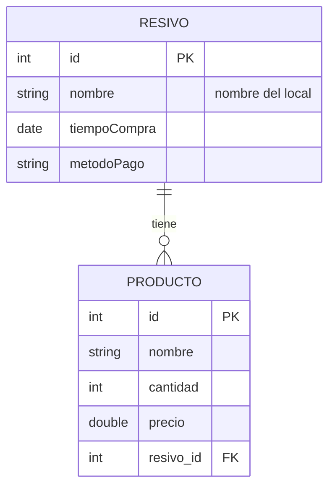

# Backend Resivo

API REST para registrar **recibos de compra** y los **productos** de cada uno. Hecha con NestJS,
TypeORM y PostgreSQL para el TP de Tecnologías Web (TUARI, UNICEN).

Este repo tiene la API y la base de datos (`database/`). El front (Angular) está en su propio
repo, y lo usa con la URL de la API.

- **API deployada:** https://resivos-api.onrender.com
- **Front:** https://resivos.netlify.app
- **Repo del front:** https://github.com/OliverioBPapuccioF/resivos-frontend

## Modelo de datos

Un recibo tiene muchos productos, y cada producto pertenece a un solo recibo (relación 1 a N).
Cada fila de `producto` guarda el `resivo_id` del recibo al que pertenece.



- El **total** del recibo no se guarda en la base: se calcula al devolver el recibo, sumando
  el `subtotal` (`cantidad × precio`) de sus productos.
- Todos los montos que calcula la API (`subtotal`, `total` y las estadísticas) se **redondean a
  2 decimales** (`src/common/dinero.ts`), para evitar resultados como `0.30000000000000004`.
- Al **borrar un recibo** se borran también sus productos (`ON DELETE CASCADE`).

## Requisitos

- Node.js 24 o superior (para correr el back en tu máquina)
- Docker con Docker Compose
- Opcionales, solo para los comandos `make`:
  - `make`
  - `curl` y `jq`: los usan `make seed` y `make probar-api`
  - `openssl`: lo usa `make deploy` para generar la contraseña de prueba

### Sin `make`

Todo lo de Docker se puede hacer con `docker compose`, desde la raíz de este repo:

| Con `make` | Sin `make` |
| ---------- | ---------- |
| `make levantar` | `cp .env.example .env && cp database/.env.example database/.env` (la primera vez) y `docker compose up -d --build --wait` |
| `make dev` | `docker compose stop api && docker compose up -d --build --wait db` |
| `make estado` | `docker compose ps -a` |
| `make logs s=api` | `docker compose logs -f api` |
| `make apagar` | `docker compose stop` |
| `make borrar` | `docker compose down --rmi local` |
| `make seed` | `bash database/seed.sh` |
| `make probar` | `bash scripts/probar-api.sh http://localhost:3000` |

## Cómo levantarlo

### 1. Instalar dependencias y crear los `.env`

```bash
npm install
cp .env.example .env                     # configuración de la API
cp database/.env.example database/.env   # usuario y contraseña de Postgres
```

Los `.env` **no se suben al repo** (están en el `.gitignore`); se suben los `.env.example`, con
los nombres de todas las variables y valores para desarrollo local. `make levantar`, `make dev`
y `make borrar-todo` los copian solos si no existen (nunca pisan los tuyos).

### 2. Levantar PostgreSQL con Docker

Desde la raíz de este repo (donde están `docker-compose.yml` y el `Makefile`):

```bash
make dev        # levanta solo la base (y apaga la API de Docker, si estaba corriendo)
```

La base se arma con `database/Dockerfile` (Postgres 18) y guarda sus datos en `database/data/`
(ignorada por git). Para apagarla: `make apagar`. Para empezar con la base vacía:
`make borrar-todo`. Para cargar datos de ejemplo (con la API levantada): `make seed`.

### Todo con Docker (base + API)

```bash
make levantar   # construye las imágenes y levanta db + api (espera a que estén healthy)
make estado     # contenedores y su estado
make logs s=api # logs de la API
```

La API queda en `http://localhost:3000` y la base en `localhost:5432`. Las dos están en la red
`red-db`: adentro de Docker la API llega a la base por el nombre `db`.

El front tiene su propio `docker-compose.yml` en su repo, con el **mismo nombre de proyecto**
(`resivos`): si después de este se corre `make levantar` allá, se suma el contenedor `web` en
la red `red-web`, que no ve a la base. Por eso `make borrar` acá no usa `--remove-orphans`
(borraría el contenedor del front).
`make` sin nada muestra todos los comandos.

### 3. Variables de entorno

Hay dos `.env`, cada uno con su `.env.example` (el que está en el repo):

| Archivo | Lo lee | Para qué |
| ------- | ------ | -------- |
| `database/.env` | el contenedor de Postgres | Usuario, contraseña y nombre de la base, zona horaria |
| `.env` | `npm start`, `start:dev`, `start:debug`, `start:prod`, el contenedor `api`, `docker compose` y `make` | Configuración del back (tabla de abajo). En Docker, el compose cambia `DB_HOST=db`, `DB_PORT=5432` y `PORT=3000`. Además, `DB_PORT_HOST` y `API_PORT_HOST`: los puertos de tu máquina donde el compose publica la base y la API |

Los scripts de npm cargan `.env` con la opción `--env-file` de Nest/Node. Una variable
definida en el sistema tiene prioridad sobre el archivo, y si falta alguna se usa el valor por
defecto del código.

| Variable      | Por defecto | Descripción              |
| ------------- | ----------- | ------------------------ |
| `PORT`        | `3000`      | Puerto de la API (en Render lo pone Render) |
| `DATABASE_URL` | —          | URL completa de conexión (Render, `docker-compose.prod.yml`). Si está, se ignoran las `DB_*` |
| `DB_HOST`     | `localhost` | Host de PostgreSQL (`db` cuando el back corre dentro de Docker) |
| `DB_PORT`     | `5432`      | Puerto de PostgreSQL (igual a `DB_PORT_HOST`) |
| `DB_USER`     | `postgres`  | Usuario de PostgreSQL (igual a `POSTGRES_USER`) |
| `DB_PASSWORD` | `postgres`  | Contraseña de PostgreSQL (igual a `POSTGRES_PASSWORD`) |
| `DB_NAME`     | `resivo`    | Nombre de la base (igual a `POSTGRES_DB`) |
| `CORS_ORIGIN` | `http://localhost:4200` | Origen del front que puede llamar a la API (CORS) |
| `TZ`          | la del sistema | Zona horaria: define qué día es "hoy" para no aceptar fechas futuras |

### 4. Ejecutar la API

```bash
# desarrollo (se reinicia sola con cada cambio)
npm run start:dev

# producción
npm run build
npm run start:prod
```

La API queda disponible en `http://localhost:3000`. Las tablas se crean solas al arrancar
(`synchronize: true` de TypeORM).

## Deploy (Render)

Deployada en **https://resivos-api.onrender.com** (el front, en https://resivos.netlify.app).

La API se deploya en [Render](https://render.com) con el Blueprint `render.yaml` de este repo:
Render construye `Dockerfile` y crea un Postgres administrado (no usa
`docker-compose` ni `database/Dockerfile`). La API recibe la conexión en `DATABASE_URL`.

Antes de deployar:

```bash
make deploy          # construye resivos-api:<versión> y la prueba "como en producción"
make deploy-borrar   # borra esa prueba local (contenedores, imágenes, datos y credenciales)
```

`make deploy` levanta `docker-compose.prod.yml`: las imágenes versionadas (versión del
`package.json`), la base **sin publicar** y en un volumen propio, credenciales aleatorias
(`deploy/prod.env`, ignorado por git) y la API en `localhost:8080`, conectada con
`DATABASE_URL` igual que en Render. Corre `scripts/probar-api.sh` y, si todo pasa, la apaga.

En Render:

1. La primera vez: **Dashboard → New → Blueprint** y elegir este repo. Pide `CORS_ORIGIN`
   (la URL del front en Netlify, `https://<sitio>.netlify.app`, sin `/` al final; si todavía
   no existe, `http://localhost:4200`). Render la pide solo al crear el Blueprint: después se
   cambia en el servicio → **Environment** → "Save and deploy". Los pasos completos, con el
   front, están en el README del [repo del front](https://github.com/OliverioBPapuccioF/resivos-frontend).
2. Después, cada `git push` a la rama del Blueprint deploya solo.
3. Para probar la API deployada: `make probar-api API=https://<tu-servicio>.onrender.com`

> ⚠ Plan gratis: el servicio se duerme sin uso (el primer pedido tarda ~1 minuto) y la base
> **vence a los 30 días** (14 días más de gracia; después Render la borra con sus datos).

## Endpoints

### Estado de la API

| Método | Ruta | Descripción | Respuesta OK |
| ------ | ---- | ----------- | ------------ |
| `GET`  | `/`  | La API está viva. **No** consulta la base: lo usan el healthcheck de Docker y el de Render (reiniciar la API no arregla una base caída) | 200 |
| `GET`  | `/salud` | La API **y la base de datos**: hace un `SELECT 1` con 3 s de límite (lo usa el front) | 200 / 503 |

```jsonc
// GET /
{ "status": "ok", "message": "API de recibos funcionando" }

// GET /salud con la base andando (200)
{ "api": "ok", "baseDeDatos": "ok" }

// GET /salud con la base caída (503)
{ "statusCode": 503, "message": "La base de datos no responde", "error": "Service Unavailable", "api": "ok", "baseDeDatos": "caida" }
```

### Recibos (`/resivo`)

| Método   | Ruta                   | Descripción                                    | Respuesta OK |
| -------- | ---------------------- | ---------------------------------------------- | ------------ |
| `GET`    | `/resivo`              | Lista todos los recibos con sus productos y total | 200       |
| `GET`    | `/resivo?nombre=texto` | Filtra los recibos cuyo nombre contiene `texto` (sin distinguir mayúsculas) | 200 |
| `GET`    | `/resivo/metodos-pago` | Lista fija de métodos de pago (para el `select` del front) | 200 |
| `GET`    | `/resivo/:id`          | Un recibo con sus productos y total            | 200          |
| `POST`   | `/resivo`              | Crea un recibo y lo devuelve igual que `GET /resivo/:id` | 201 |
| `PATCH`  | `/resivo/:id`          | Modifica uno o más campos de un recibo y lo devuelve igual que `GET /resivo/:id` | 200 |
| `DELETE` | `/resivo/:id`          | Borra un recibo y sus productos                | 200          |

Body de `POST /resivo` (en `PATCH` todos los campos son opcionales, pero tiene que venir al menos uno).
`metodoPago` tiene que ser uno de: `Efectivo`, `Débito`, `Crédito`, `Transferencia` (la misma lista que devuelve `GET /resivo/metodos-pago`).

```json
{
  "nombre": "Kiosco El Sol",
  "tiempoCompra": "2026-10-18",
  "metodoPago": "Efectivo"
}
```

Respuesta de `GET /resivo/:id`:

```json
{
  "id": 4,
  "nombre": "Kiosco El Sol",
  "tiempoCompra": "2026-10-18",
  "metodoPago": "Efectivo",
  "productos": [
    { "id": 5, "nombre": "Coca-Cola 1.5L", "cantidad": 2, "precio": 2500, "subtotal": 5000 },
    { "id": 6, "nombre": "Alfajor Jorgito", "cantidad": 3, "precio": 800, "subtotal": 2400 }
  ],
  "total": 7400
}
```

### Estadísticas (`/resivo/estadisticas`)

Datos para la página de inicio del front. Se calculan en el momento con todos los recibos cargados.

| Método | Ruta | Descripción | Respuesta OK |
| ------ | ---- | ----------- | ------------ |
| `GET`  | `/resivo/estadisticas/ultimos`     | Los 5 recibos más recientes por fecha de compra | 200 |
| `GET`  | `/resivo/estadisticas/metodo-pago` | Cuántos recibos hay por método de pago y cuál es el más usado | 200 |
| `GET`  | `/resivo/estadisticas/por-fecha`   | Gasto total por fecha de compra (de la más vieja a la más nueva) | 200 |
| `GET`  | `/resivo/estadisticas/por-local`   | Gasto total por local, agrupado por nombre (sin distinguir mayúsculas ni espacios de más), de mayor a menor | 200 |

```jsonc
// GET /resivo/estadisticas/ultimos
[{ "id": 4, "nombre": "Kiosco El Sol", "tiempoCompra": "2026-10-18", "total": 7400 }]

// GET /resivo/estadisticas/metodo-pago  (masUsado es null si no hay recibos)
{
  "masUsado": "Efectivo",
  "cantidades": [
    { "metodoPago": "Efectivo", "cantidad": 3 },
    { "metodoPago": "Débito", "cantidad": 1 },
    { "metodoPago": "Crédito", "cantidad": 0 },
    { "metodoPago": "Transferencia", "cantidad": 0 }
  ]
}

// GET /resivo/estadisticas/por-fecha
[{ "fecha": "2026-10-18", "total": 7400, "cantidadRecibos": 1 }]

// GET /resivo/estadisticas/por-local
[{ "nombre": "Kiosco El Sol", "total": 7400, "cantidadRecibos": 1 }]
```

### Productos (`/producto`)

| Método   | Ruta                     | Descripción                                     | Respuesta OK |
| -------- | ------------------------ | ----------------------------------------------- | ------------ |
| `GET`    | `/producto`              | Lista todos los productos con su recibo         | 200          |
| `GET`    | `/producto?nombre=texto` | Filtra los productos cuyo nombre contiene `texto` (sin distinguir mayúsculas) | 200 |
| `GET`    | `/producto/:id`          | Un producto con su recibo                       | 200          |
| `POST`   | `/producto`              | Crea un producto dentro de un recibo y lo devuelve igual que `GET /producto/:id` | 201 |
| `PATCH`  | `/producto/:id`          | Modifica uno o más campos de un producto (también puede moverlo de recibo) | 200 |
| `DELETE` | `/producto/:id`          | Borra un producto                               | 200          |

Body de `POST /producto` (en `PATCH` todos los campos son opcionales, pero tiene que venir al menos uno):

```json
{
  "nombre": "Coca-Cola 1.5L",
  "cantidad": 2,
  "precio": 2500,
  "resivoId": 4
}
```

Respuesta de `GET /producto/:id` (`resivoId` y `subtotal` los agrega la API):

```json
{
  "id": 5,
  "nombre": "Coca-Cola 1.5L",
  "cantidad": 2,
  "precio": 2500,
  "resivo": { "id": 4, "nombre": "Kiosco El Sol", "tiempoCompra": "2026-10-18", "metodoPago": "Efectivo" },
  "resivoId": 4,
  "subtotal": 5000
}
```

## Colección de Postman

`postman/resivos.postman_collection.json` (formato Postman v2.1) tiene **todos los casos de
uso** de la API, con tests en cada pedido (35 pedidos, 74 verificaciones):

| Carpeta | Pedidos |
| ------- | ------- |
| 0. Estado de la API | `GET /` y `GET /salud` |
| 1. Recibos (CRUD y filtro) | listar, métodos de pago, crear, ver, filtrar con `?nombre=` y modificar |
| 2. Productos (CRUD y filtro) | crear (en el recibo creado), listar, ver, filtrar con `?nombre=`, modificar, ver que el total del recibo cambió, borrar y ver que ya no existe |
| 3. Estadísticas | las 4 |
| 4. Errores | body vacío, fecha futura, fecha inexistente, método de pago inválido, `PATCH` sin campos, precio con 3 decimales, JSON mal escrito (400); recibo inexistente, producto en un recibo inexistente, ruta inexistente (404); id que no es un número (400) |
| 5. Borrar el recibo (y sus productos) | agrega otro producto, borra el recibo y comprueba que el producto se borró en cascada |

- La URL de la API es la variable de la colección **`{{baseUrl}}`** (`http://localhost:3000`
  por defecto). Para usarla contra Render, cambiarla por `https://resivos-api.onrender.com`.
- Hay que correrla **en orden** (o entera): "Crear recibo" guarda su id en `{{resivoId}}` y
  "Crear producto" en `{{productoId}}`, que usan los pedidos siguientes.
- Todo lo que crea lo borra al final, así que se puede correr contra Render sin ensuciar
  los datos.

Desde la terminal, sin instalar Postman, con [Newman](https://github.com/postmanlabs/newman)
(el runner oficial de Postman):

```bash
make postman                                          # contra la API local
make postman API=https://resivos-api.onrender.com     # contra Render
```

También se puede **importar** en Postman (Import → el archivo) o en Thunder Client, la
extensión de VS Code (Collections → menú → Import → el archivo, formato Postman 2.1).

## Validaciones y errores

Los bodies se validan con `class-validator`:

- Los campos que no están en el DTO se descartan sin error.
- A los textos se les recortan los espacios de los costados antes de validar (`"  Día "` se guarda `"Día"`).
- Se informa **un mensaje por campo**: el de la primera regla que falla.
- `tiempoCompra` tiene que tener el formato `AAAA-MM-DD`, ser una fecha real y no ser posterior a hoy.
- `precio` acepta hasta 2 decimales y puede ser 0 o negativo (descuentos y promociones).

Todos los errores tienen la forma estándar de Nest, con el mensaje en castellano.
`message` es una **lista** en los errores de validación del body y un **texto** en el resto:

```json
{
  "statusCode": 400,
  "message": ["El nombre del local es obligatorio", "La fecha de compra no puede ser posterior a hoy"],
  "error": "Bad Request"
}
```

| Caso | Código | Mensaje |
| ---- | ------ | ------- |
| Falta un campo obligatorio | 400 | `El nombre del local es obligatorio`, `La cantidad es obligatoria`, … (lista) |
| Tipo o formato incorrecto | 400 | `La fecha de compra tiene que tener el formato AAAA-MM-DD`, `La cantidad tiene que ser un número entero`, … (lista) |
| Fecha inexistente (ej. `2026-02-30`) | 400 | `La fecha de compra no es una fecha válida` (lista) |
| Fecha futura | 400 | `La fecha de compra no puede ser posterior a hoy` (lista) |
| Método de pago fuera de la lista | 400 | `El método de pago tiene que ser uno de: Efectivo, Débito, Crédito, Transferencia` (lista) |
| Precio con más de 2 decimales | 400 | `El precio tiene que ser un número con hasta 2 decimales` (lista) |
| `PATCH` sin ningún campo válido | 400 | `Tenés que mandar al menos un campo para actualizar: …` |
| `:id` no es un entero mayor a 0 (ej. `/resivo/abc`) | 400 | `El id tiene que ser un número entero mayor a 0` |
| Body con JSON mal escrito | 400 | `El body no es un JSON válido` |
| No existe el recibo | 404 | `Recibo con id X no encontrado` |
| No existe el producto | 404 | `Producto con id X no encontrado` |
| Se crea o mueve un producto a un `resivoId` que no existe | 404 | `Recibo con id X no encontrado` |
| Ruta inexistente | 404 | `La ruta GET /xxx no existe` |
| Falla la base de datos | 500 | `No se pudieron obtener los recibos`, `No se pudo crear el producto`, … (el detalle queda en la consola del back) |

Respuestas de un `DELETE` exitoso (200):

```json
{ "message": "Recibo \"Día\" eliminado correctamente (junto con 2 productos)", "status": "success" }
{ "message": "Producto \"Leche\" eliminado correctamente", "status": "success" }
```

## Estructura

```
.
├── src/                    # el código de la API (abajo)
├── test/                   # tests e2e
├── database/               # imagen de PostgreSQL 18 (Dockerfile + .env.example) y seed.sh
├── .env.example            # configuración de la API (se copia a .env)
├── scripts/probar-api.sh   # prueba de humo de una API levantada (make probar)
├── Dockerfile              # imagen de la API (la misma que construye Render)
├── docker-compose.yml      # db + api, para desarrollo
├── docker-compose.prod.yml # prueba local "como en producción" (make deploy)
├── render.yaml             # Blueprint de Render: API + Postgres
├── postman/                # colección de Postman (make postman)
├── Makefile                # comandos de Docker (make = ayuda)
└── conversation-*.txt      # conversación con Claude Code (primera entrega)
```

```
src/
├── main.ts                 # arranque, CORS, ValidationPipe y filtro de errores globales
├── common/
│   ├── errores.filter.ts   # todos los errores salen con la misma forma y en castellano
│   ├── parse-id.pipe.ts    # valida el :id de las rutas
│   └── validaciones.ts     # recortar textos, fecha no futura
├── app.module.ts           # conexión a PostgreSQL (TypeORM)
├── resivo/
│   ├── entities/           # entidad Resivo (cálculo del total)
│   ├── metodo-pago.ts      # lista fija de métodos de pago
│   ├── dto/                # CreateResivoDto, UpdateResivoDto
│   ├── resivo.controller.ts
│   ├── resivo.service.ts
│   └── resivo.module.ts
└── producto/
    ├── entities/           # entidad Producto (relación con Resivo)
    ├── dto/                # CreateProductoDto, UpdateProductoDto
    ├── producto.controller.ts
    ├── producto.service.ts
    └── producto.module.ts  # importa ResivoModule para validar el resivoId
```
