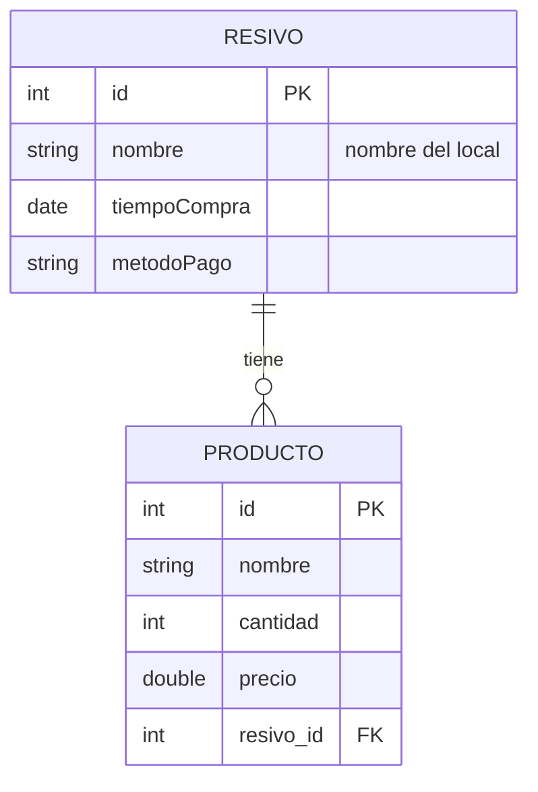

# Backend Resivo

API REST para registrar **recibos de compra** y los **productos** de cada uno. Hecha con NestJS,
TypeORM y PostgreSQL para el TP de Tecnologías Web (TUARI, UNICEN).

## Modelo de datos

Un recibo tiene muchos productos, y cada producto pertenece a un solo recibo (relación 1 a N).
Cada fila de `producto` guarda el `resivo_id` del recibo al que pertenece.



- El **total** del recibo no se guarda en la base: se calcula al devolver el recibo, sumando
  `cantidad × precio` de sus productos.
- Al **borrar un recibo** se borran también sus productos (`ON DELETE CASCADE`).

## Requisitos

- Node.js 24 o superior
- Docker (para la base de datos)

## Cómo levantarlo

### 1. Instalar dependencias

```bash
npm install
```

### 2. Levantar PostgreSQL con Docker

Desde esta carpeta (`backend-resivo/`):

```bash
docker compose up -d
```

Para detener la base:

```bash
docker compose down
```

Para detenerla y borrar también los datos:

```bash
docker compose down -v
```

### 3. Variables de entorno

La conexión a la base se configura con variables de entorno. Están listadas en `.env.example`.
Si una variable no está definida, se usa el valor por defecto, que coincide con el
`docker-compose.yml`, así que para desarrollo local no hace falta definir ninguna.

| Variable      | Por defecto | Descripción              |
| ------------- | ----------- | ------------------------ |
| `PORT`        | `3000`      | Puerto de la API         |
| `DB_HOST`     | `localhost` | Host de PostgreSQL       |
| `DB_PORT`     | `5432`      | Puerto de PostgreSQL     |
| `DB_USER`     | `postgres`  | Usuario de PostgreSQL    |
| `DB_PASSWORD` | `postgres`  | Contraseña de PostgreSQL |
| `DB_NAME`     | `resivo`    | Nombre de la base        |

### 4. Ejecutar la API

```bash
# desarrollo (se reinicia sola con cada cambio)
npm run start:dev

# producción
npm run build
npm run start:prod
```

La API queda disponible en `http://localhost:3000`. Las tablas se crean solas al arrancar
(`synchronize: true` de TypeORM).

## Endpoints

### Recibos (`/resivo`)

| Método   | Ruta                   | Descripción                                    | Respuesta OK |
| -------- | ---------------------- | ---------------------------------------------- | ------------ |
| `GET`    | `/resivo`              | Lista todos los recibos con sus productos y total | 200       |
| `GET`    | `/resivo?nombre=texto` | Filtra los recibos cuyo nombre contiene `texto` | 200         |
| `GET`    | `/resivo/buscar?nombre=texto` | Busca recibos por nombre, sin distinguir mayúsculas | 200 |
| `GET`    | `/resivo/:id`          | Un recibo con sus productos y total            | 200          |
| `POST`   | `/resivo`              | Crea un recibo                                 | 201          |
| `PATCH`  | `/resivo/:id`          | Modifica uno o más campos de un recibo         | 200          |
| `DELETE` | `/resivo/:id`          | Borra un recibo y sus productos                | 200          |

Body de `POST /resivo` (en `PATCH` todos los campos son opcionales):

```json
{
  "nombre": "Kiosco El Sol",
  "tiempoCompra": "2026-10-18",
  "metodoPago": "Efectivo"
}
```

Respuesta de `GET /resivo/:id`:

```json
{
  "id": 4,
  "nombre": "Kiosco El Sol",
  "tiempoCompra": "2026-10-18",
  "metodoPago": "Efectivo",
  "productos": [
    { "id": 5, "nombre": "Coca-Cola 1.5L", "cantidad": 2, "precio": 2500 },
    { "id": 6, "nombre": "Alfajor Jorgito", "cantidad": 3, "precio": 800 }
  ],
  "total": 7400
}
```

### Productos (`/producto`)

| Método   | Ruta                     | Descripción                                     | Respuesta OK |
| -------- | ------------------------ | ----------------------------------------------- | ------------ |
| `GET`    | `/producto`              | Lista todos los productos con su recibo         | 200          |
| `GET`    | `/producto?nombre=texto` | Filtra los productos cuyo nombre contiene `texto` | 200        |
| `GET`    | `/producto/buscar?nombre=texto` | Busca productos por nombre, sin distinguir mayúsculas | 200 |
| `GET`    | `/producto/:id`          | Un producto con su recibo                       | 200          |
| `POST`   | `/producto`              | Crea un producto dentro de un recibo            | 201          |
| `PATCH`  | `/producto/:id`          | Modifica uno o más campos de un producto        | 200          |
| `DELETE` | `/producto/:id`          | Borra un producto                               | 200          |

Body de `POST /producto` (en `PATCH` todos los campos son opcionales):

```json
{
  "nombre": "Coca-Cola 1.5L",
  "cantidad": 2,
  "precio": 2500,
  "resivoId": 4
}
```

## Validaciones y errores

Los bodies se validan con `class-validator`. Los campos que no están en el DTO se descartan.

| Código | Cuándo                                                                     |
| ------ | -------------------------------------------------------------------------- |
| `400`  | Body inválido (campo faltante, vacío, tipo incorrecto, número no positivo) |
| `400`  | El `:id` de la ruta no es un número (ej. `/resivo/abc`)                    |
| `404`  | No existe el recibo o producto con ese `:id`                               |
| `404`  | Se crea o mueve un producto a un `resivoId` que no existe                  |

Ejemplo de respuesta `400`:

```json
{
  "message": ["nombre should not be empty", "tiempoCompra must be a valid ISO 8601 date string"],
  "error": "Bad Request",
  "statusCode": 400
}
```

## Estructura

```
src/
├── main.ts                 # arranque y ValidationPipe global
├── app.module.ts           # conexión a PostgreSQL (TypeORM)
├── resivo/
│   ├── entities/           # entidad Resivo (cálculo del total)
│   ├── dto/                # CreateResivoDto, UpdateResivoDto
│   ├── resivo.controller.ts
│   ├── resivo.service.ts
│   └── resivo.module.ts
└── producto/
    ├── entities/           # entidad Producto (relación con Resivo)
    ├── dto/                # CreateProductoDto, UpdateProductoDto
    ├── producto.controller.ts
    ├── producto.service.ts
    └── producto.module.ts  # importa ResivoModule para validar el resivoId
```
